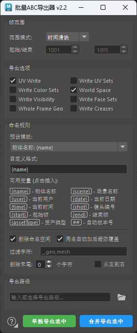

# 批量ABC导出器 (Batch ABC Exporter) v2.2

一款为 Autodesk Maya 打造的 **Alembic (ABC) 批量导出工具**，提供图形化界面，支持一键将多个选中物体分别导出为独立 ABC 文件，或合并导出为单个文件，内置智能命名模板、自动版本号、同名防覆盖与设置记忆，大幅简化动画缓存（Cache）产出流程。



## 目录

- [功能特性](#功能特性)
- [对比 Maya 自带 ABC 导出的优势](#对比-maya-自带-abc-导出的优势)
- [环境要求](#环境要求)
- [安装方法](#安装方法)
- [使用方法](#使用方法)
- [命名规则变量](#命名规则变量)
- [更新日志](#更新日志)

## 功能特性

### 两种导出方式

- **单独导出选中**：选中的每个物体（或组）各自导出为一个独立 `.abc` 文件，适合按角色 / 按资产拆分缓存。
- **合并导出选中**：将所有选中物体合并导出为一个 `.abc` 文件，适合整镜头缓存。

### 帧范围

- **当前帧**：仅导出当前时间轴位置。
- **时间滑块**：自动读取播放范围（起止帧随场景实时同步）。
- **自定义**：手动指定起止帧。

### 完整的 Alembic 导出选项

UV Write、Write UV Sets、Write Color Sets、World Space、Write Visibility、Write Face Sets、Whole Frame Geo、Write Creases 全部以勾选框形式提供，所见即所得。

### 智能命名规则

- **6 套预设模板**：物体名称、角色动画、场景缓存、镜头版本、日期版本、时间范围，开箱即用。
- **自定义格式**：支持 10 个变量自由组合（详见[命名规则变量](#命名规则变量)）。
- **变量一键插入**：点击变量按钮即可插入到光标位置，自动补全下划线分隔。
- **自动版本号**：`##` 自动展开为 `v001`、`v002`…，导出时自动跳过已存在版本，上限 v999。
- **同名防覆盖**：目标文件已存在时自动追加 `_001`、`_002` 后缀，多个同名物体按 `{name}` 规则导出时不会相互覆盖。

### 名称清洗

- **删除命名空间**：一键去除物体名中的命名空间前缀（`NS:Rig:Body` → `Body`）。
- **过滤字符**：按逗号分隔批量删除指定字符（如 `_,geo,mesh`）。
- **删除末尾 / 开头 N 个字符**：支持从左或从右截断。
- **非法字符替换**：自动将文件名非法字符（`\\ / : * ? " < > |`）替换为下划线。

### 体验细节

- **进度对话框**：实时显示当前导出物体与整体进度，**ESC 可随时中断**，中断后已完成的文件正常保留。
- **默认设置记忆**：右键点击 `?` 按钮可保存当前参数为默认、恢复出厂默认或打开设置文件夹；下次启动自动应用。设置存档位于 Maya 用户脚本目录（`abc_exporter_settings.json`），损坏时自动回退出厂默认。
- **双窗口模式**：支持独立浮动窗口与停靠面板（可嵌入属性编辑器旁）。
- **深浅主题适配**：界面元素颜色跟随 Maya 主题自动调整。

## 对比 Maya 自带 ABC 导出的优势

Maya 自带的 Alembic 导出（`Cache → Alembic Cache → Export Selection` 或 `AbcExport` MEL 命令）只能满足单文件、单次导出的基本需求，面对批量缓存工作流程时存在明显短板：

| 对比项 | Maya 自带 ABC 导出 | 批量ABC导出器 v2.2 |
| --- | --- | --- |
| 批量单独导出 | ❌ 一次只能导出一个合并文件，每个物体独立成文件需逐个手动操作 | ✅ 选中任意数量物体，一键各自导出独立 ABC |
| 合并导出 | ✅ 支持 | ✅ 支持（带进度与汇总反馈） |
| 文件命名 | 每次导出手动输入文件名 | ✅ 6 套预设模板 + 10 个变量自动生成文件名 |
| 版本管理 | 手动改名维护 v001、v002… | ✅ `##` 自动版本号，自动递增跳过已有版本 |
| 同名防覆盖 | ❌ 直接覆盖或导出失败 | ✅ 自动追加 `_001` / `_002` 后缀防覆盖 |
| 命名空间清理 | ❌ 缓存内节点名保留命名空间前缀 | ✅ 可选删除命名空间，产出干净缓存 |
| 文件名清洗 | ❌ 无 | ✅ 过滤字符、截断、非法字符替换 |
| 导出选项 | 需记住 `AbcExport` 旗标语法（如 `-uvWrite` 为布尔旗标，写法错误即失效） | ✅ 勾选框图形化，所见即所得，自动生成合法命令 |
| 导出过程反馈 | ❌ 阻塞式执行，无进度显示 | ✅ 实时进度条 + 当前物体名 + 成功/失败汇总 |
| 中途取消 | ❌ 无法中断 | ✅ ESC 一键中断，已完成部分保留 |
| 设置记忆 | ❌ 每次导出重新设置 | ✅ 一键保存/恢复默认，跨会话记忆 |
| 使用门槛 | 需要熟悉 MEL 命令行参数 | ✅ 图形界面零门槛 |

**一句话总结**：Maya 自带导出是"一次一个文件、全手动命名"的原始流程；本插件把它升级为"一键批量、自动命名、自动版本、可中断、可记忆"的生产级缓存流水线，尤其适合动画、绑定、资产管理环节需要频繁产出 Alembic 缓存的场景。

## 环境要求

- Autodesk Maya（PySide2 / PySide6 均可，即 Maya 2017 及以上版本均兼容，Maya 2025+ 使用 PySide6）
- 无任何第三方依赖

## 安装方法

1. 将 `Batch_ABC_Export.py` 复制到 Maya 的用户脚本目录：

   - Windows: `文档\maya\scripts\`
   - macOS: `~/Library/Preferences/Autodesk/maya/scripts/`
   - Linux: `~/maya/scripts/`

2. 在 Maya 的 **Python** 选项卡中执行：

   ```python
   import Batch_ABC_Export
   Batch_ABC_Export.show()            # 浮动窗口模式
   # Batch_ABC_Export.create_dockable()  # 或停靠面板模式
   ```

3. （可选）中键拖拽 MEL 按钮历史到工具架，创建一键启动按钮。

> 提示：设置存档 `abc_exporter_settings.json` 自动保存在 Maya 用户脚本目录，与脚本本体存放位置无关，重装 / 更新脚本不会丢失默认设置。

## 使用方法

1. 在场景中选择要导出的物体或组（可多选）。
2. 设置帧范围模式（当前帧 / 时间滑块 / 自定义）。
3. 按需勾选导出选项（UV、World Space、Face Sets 等）。
4. 配置命名规则：选择预设模板，或用变量按钮组合自定义格式。
5. 输入或选择导出路径。
6. 点击 **单独导出选中**（每个物体一个文件）或 **合并导出选中**（全部合为一个文件）。
7. 等待进度条完成；需要中途停止时按 **ESC**。

## 命名规则变量

在自定义格式中可使用以下变量（主界面点击变量按钮可直接插入）：

| 变量 | 说明 | 示例 |
| --- | --- | --- |
| `{name}` | 物体名称（经名称清洗后） | `Hero_Rig` |
| `{scene}` | 当前场景名称 | `EP01_SC010` |
| `{user}` | 当前系统用户 | `zhangsan` |
| `{date}` | 当前日期 | `20261011` |
| `{time}` | 当前时间 | `143000` |
| `{shot}` | 镜头编号 | `SHOT001` |
| `{start}` | 起始帧 | `1001` |
| `{end}` | 结束帧 | `1100` |
| `{assetType}` | 资产类型 | `character` |
| `##` | 自动版本号（v001 起，自动跳过已存在版本） | `v001` |

模板示例：`{scene}_{name}_##` → `EP01_SC010_Hero_v001.abc`

## 更新日志

### v2.2

- **[新增] 默认设置保存与恢复**：右键点击主界面左下角的 `?` 按钮（图标右下角新增小三角提示），可把当前全部参数保存为默认、恢复出厂默认或打开设置文件夹；下次启动插件时自动应用已保存的默认参数。
- **[优化] 可用变量两列排布**：命名规则的可用变量列表改为一行两个、两列排布，面板更紧凑。

### v2.1

- **[新增] 可用变量一键插入**：可用变量由纯文本说明改为可点击按钮，点击即把变量插入自定义格式输入框的光标位置。

### v2.0

- **[修复] 导出选项不生效**：UV Write 等八个导出开关现已按勾选状态正确生效（修复布尔旗标误带参数值导致的失效问题）。
- **[新增] 同名自动加后缀防覆盖**：导出遇到同名文件时自动追加 `_001`、`_002` 等后缀，多个同名物体单独导出时不再相互覆盖。
- **[优化] 帮助窗口选项卡化**：帮助窗口改为「更新日志 / 使用帮助」两个可切换选项卡。
