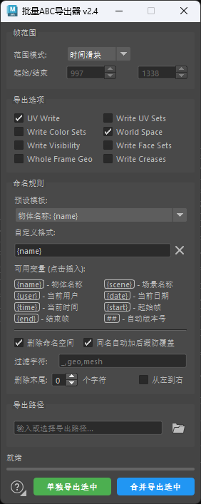
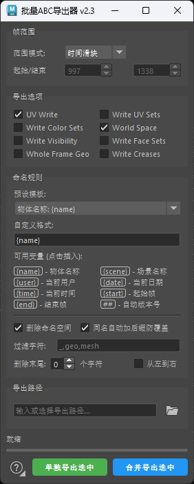
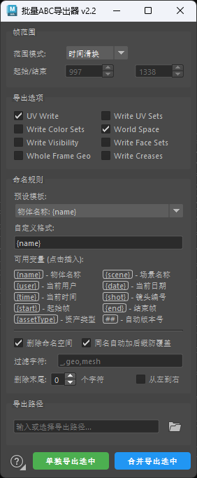
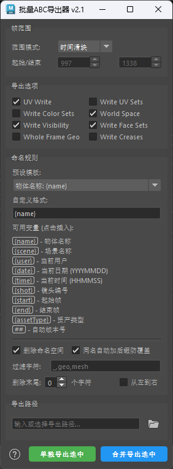
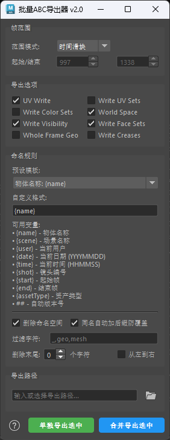
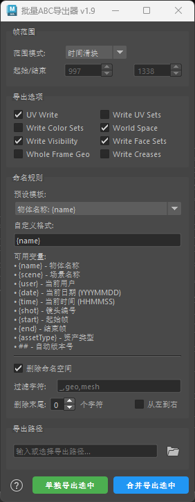
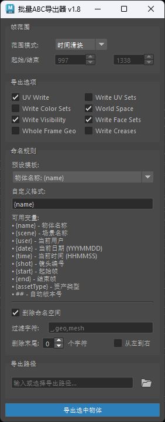
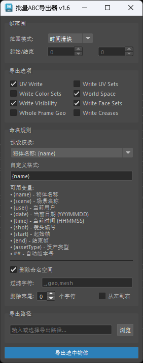
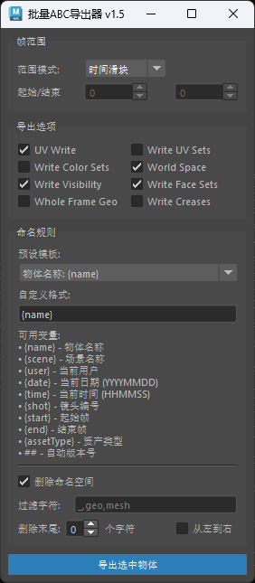
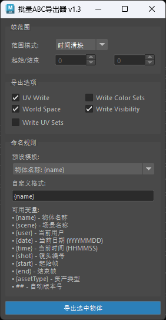

# 批量ABC导出器（Batch ABC Exporter）更新日志

> - **v2.0 – v2.4**：整理自插件「帮助窗口 → 更新日志」选项卡中的原始记录，内容与原文一致。
> - **v1.3 – v1.9**：无历史文字记录，由各版本源码逐版对比整理补齐。
> - v1.0 – v1.2、v1.4 无存档文件，无对应日志。
> - 各版本条目左侧为该版本的界面截图，图片位于对应版本文件夹内。

## v2.4

<table>
<tr>
<td width="282" valign="top">

</td>
<td valign="top">

- **[新增] 自定义格式一键清空**
  点击即可清空格式内容并同步模板为“自定义”。
- **[移除] 去除窗口最大化按钮**
  插件独立窗口标题栏只保留最小化与关闭按钮，不再显示最大化按钮。
- **[优化] 进度百分比只显示整数**
  底部进度条百分比文字去除小数，只显示整数百分比。

</td>
</tr>
</table>

## v2.3

<table>
<tr>
<td width="282" valign="top">

</td>
<td valign="top">

- **[新增] 导出进度改为底部常驻进度条**
  移除导出进度弹窗，主界面底部新增常驻的状态文本与细进度条，实时显示当前进度与正在处理的物体。
- **[修复] ? 按钮右键菜单关闭后悬浮高亮残留**
  右键菜单关闭后，? 按钮不再保持悬浮状态的背景高亮。
- **[移除] {assetType} 资产类型与 {shot} 镜头编号变量**
  两者此前始终输出固定占位值（character / SHOT001），已从可用变量中移除；「场景缓存」「镜头版本」预设模板改用 {scene} 场景名称。
- **[移除] 导出进度窗口**
  导出进度不再以窗口弹出，集成到插件面板中。

</td>
</tr>
</table>

## v2.2

<table>
<tr>
<td width="282" valign="top">

</td>
<td valign="top">

- **[新增] 默认设置保存与恢复**
  右键点击主界面左下角的 ? 按钮（图标右下角新增小三角提示），可把当前全部参数保存为默认、恢复出厂默认或打开设置文件夹；下次启动插件时自动应用已保存的默认参数。设置存档位于 Maya 用户脚本目录（abc_exporter_settings.json）。
- **[优化] 可用变量两列排布**
  命名规则的可用变量列表改为一行两个、两列排布，利用原列表右侧的空白区域，面板更紧凑。

</td>
</tr>
</table>

## v2.1

<table>
<tr>
<td width="282" valign="top">

</td>
<td valign="top">

- **[新增] 可用变量一键插入**
  命名规则中的可用变量（{name}、{scene}、## 等）由纯文本说明改为可点击按钮，点击即把变量插入自定义格式输入框的光标位置。

</td>
</tr>
</table>

## v2.0

<table>
<tr>
<td width="282" valign="top">

</td>
<td valign="top">

- **[修复] 导出选项不生效**
  UV Write、Write UV Sets、Write Color Sets、World Space、Write Visibility、Write Face Sets、Whole Frame Geo、Write Creases 现已按勾选状态正确生效。
- **[新增] 同名自动加后缀防覆盖**（默认开启）
  导出遇到同名文件时自动追加 _001、_002 等后缀生成新文件；多个同名物体按 {name} 规则导出时不再相互覆盖，单独导出与合并导出均支持。
- **[优化] 帮助窗口选项卡化**
  帮助窗口改为「更新日志 / 使用帮助」两个可切换选项卡。

</td>
</tr>
</table>

## v1.9

<table>
<tr>
<td width="282" valign="top">

</td>
<td valign="top">

- **[新增] 合并导出选中**
  新增「合并导出选中」按钮，可将所有选中物体合并导出为一个 ABC 文件（以最后一个选中物体命名并套用命名规则）；原导出按钮更名为「单独导出选中」，仍为每个物体单独生成一个文件。
- **[新增] 使用帮助窗口**
  主界面左下角新增 ? 帮助按钮，打开图文使用帮助，涵盖帧范围、导出选项、命名规则、高级选项、导出方式与使用步骤。
- **[新增] PySide6 / PySide2 双版本兼容**
  自动检测运行环境，优先使用 PySide6，不存在时回退 PySide2，兼容新版 Maya。

</td>
</tr>
</table>

## v1.8

<table>
<tr>
<td width="282" valign="top">

</td>
<td valign="top">

- **[优化] 界面图标改用 Maya 内置图标**
  导出路径的「浏览」按钮由文字改为 Maya 内置打开文件图标，扁平无边框样式并带悬浮高亮，与 Maya 界面风格更统一。

</td>
</tr>
</table>

## v1.7

<table>
<tr>
<td width="282" valign="top">

</td>
<td valign="top">

- **[新增] 导出进度对话框**
  导出时弹出进度窗口，显示整体进度条、正在导出的物体名称及已完成 / 总数。
- **[新增] ESC 中断导出**
  导出过程中可按 ESC 键或点击「取消」按钮中断，剩余物体将跳过，并提示已完成数量。

</td>
</tr>
</table>

## v1.6

<table>
<tr>
<td width="282" valign="top">

</td>
<td valign="top">

- **[新增] 导出路径设置**
  主界面新增「导出路径」分组，可手动输入路径或点击「浏览」选择目录，导出时不再每次弹出目录选择对话框。
- **[优化] 路径自动规范与校验**
  输入的路径自动统一为正斜杠格式并补全末尾斜杠；导出前校验路径，未设置或路径不存在时给出警告。

</td>
</tr>
</table>

## v1.5

<table>
<tr>
<td width="282" valign="top">

</td>
<td valign="top">

- **[新增] 名称高级处理**
  命名规则内新增高级选项：删除命名空间（默认开启）、过滤字符（逗号分隔多个）、删除末尾指定数量字符，并可勾选「从左到右」改为从名称开头删除。
- **[新增] 导出选项扩充**
  新增 Write Face Sets、Whole Frame Geo、Write Creases 三个导出选项。
- **[优化] 帧数输入范围扩大**
  起始 / 结束帧输入范围扩至 ±100000，支持负帧数与长镜头。
- **[优化] 自动版本号扩展为三位**
  ## 生成的版本号由两位（v01 – v99）扩展为三位（v001 – v999）。

</td>
</tr>
</table>

## v1.3

<table>
<tr>
<td width="282" valign="top">

</td>
<td valign="top">

*现存最早版本（v1.0 – v1.2 无存档），以下为该版本已具备的初始功能。*

- **[新增] 批量 ABC 导出**
  选择多个物体或组后批量导出，每个物体单独生成一个 ABC 文件，导出时弹出目录选择对话框，完成后汇总导出结果。
- **[新增] 帧范围三种模式**
  当前帧 / 时间滑块 / 自定义，默认使用时间滑块范围。
- **[新增] 导出选项**
  支持 UV Write、Write Color Sets、World Space、Write Visibility、Write UV Sets 五项勾选。
- **[新增] 命名规则与预设模板**
  7 个预设模板（物体名称 / 角色动画 / 场景缓存 / 镜头版本 / 日期版本 / 时间范围 / 自定义）+ 自定义格式；支持 {name}、{scene}、{user}、{date}、{time}、{shot}、{start}、{end}、{assetType} 与 ## 自动版本号（v01 – v99）十个变量。
- **[新增] 文件名合法性处理**
  导出前自动将文件名中的非法字符替换为下划线。

</td>
</tr>
</table>
